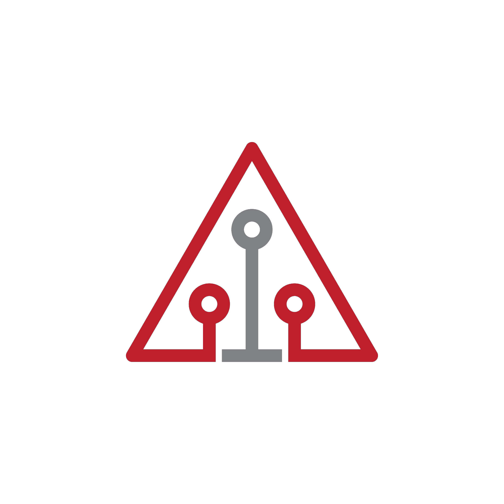
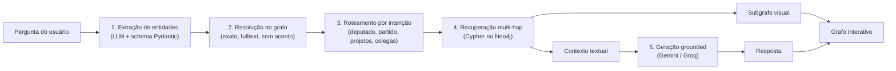
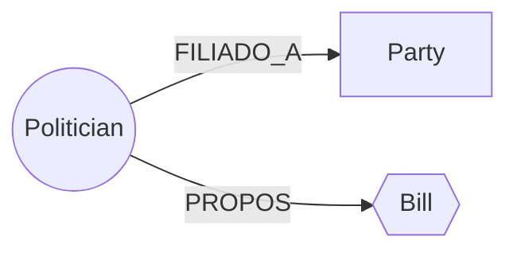

<div align="center">



# UaiGraph

**Graph RAG sobre a bancada de Deputados Federais de Minas Gerais**

Pergunte em linguagem natural sobre deputados, partidos e projetos de lei e receba uma resposta fundamentada nos dados oficiais da Câmara, junto com o grafo de relações que sustenta essa resposta.

[Demo online](https://uaigraph.pages.dev/)

</div>

---

## Sobre o projeto

O UaiGraph modela a atividade legislativa dos 53 deputados federais mineiros como um **grafo de conhecimento** no Neo4j (parlamentares, partidos, proposições e suas relações). A cada pergunta, o sistema percorre esse grafo para recuperar apenas os fatos relevantes e só então usa um LLM para redigir a resposta.

O resultado é uma resposta **auditável**: o usuário vê o texto e o subgrafo de evidências que o originou.

**Exemplos de perguntas**

- *Quem é Célia Xakriabá e quais projetos ela propôs?*
- *Quem são os deputados do mesmo partido de Nikolas Ferreira?*
- *Quais as principais propostas da bancada?*

### Destaques

- **Graph RAG sem alucinação de entidades:** o LLM só recebe o contexto recuperado do grafo e é instruído a não extrapolar dele.
- **Resolução de entidades tolerante a erros:** "Celia Xakriaba", "Nikolas" ou "PL" apontam para o nó correto (sem acento, apelido ou erro de digitação).
- **Respostas isoladas por intenção:** perguntar sobre um deputado mostra só ele, seus projetos e seu partido. Colegas de bancada só aparecem quando a pergunta pede.
- **Resiliência de provedores de LLM:** Gemini como principal, Groq como fallback automático com janela de *cooldown* em caso de limite de cota.
- **Interface responsiva:** layouts separados para desktop (tela dividida) e mobile (navegação em abas).

---

## Como o RAG funciona

Diferente de um RAG vetorial (busca por similaridade de embeddings), aqui a recuperação é feita por **travessia de grafo**. Os dados são altamente relacionais, e perguntas como *"quem são os colegas de partido de X?"* se resolvem com precisão em Cypher, não com similaridade semântica.



**1. Extração de entidades** ([`app/llm/extraction.py`](app/llm/extraction.py))
O LLM identifica deputados, siglas de partido e códigos de projeto citados, devolvendo JSON validado pelo schema Pydantic. Um filtro léxico descarta termos genéricos ("câmara", "projetos", "deputados") e expressões regulares reforçam a captura precisa de legendas partidárias.

**2. Resolução de entidades** ([`app/graph/resolver.py`](app/graph/resolver.py))
A menção informal é convertida no nó canônico exato por meio de uma cascata de estratégias: verificação de partidos conhecidos, correspondência exata, busca *fulltext* (Lucene) tolerante a erros de digitação, correspondência fonética sem acentos e sobreposição de termos com limiar anti-falso-positivo. Possui cache em memória com TTL.

**3. Roteamento por intenção** ([`app/services/chat_service.py`](app/services/chat_service.py))
O serviço analisa o teor semântico da pergunta (bancada completa, proposições em destaque ou colegas de mesma legenda) e decide a estratégia de recuperação, evitando poluição de contexto.

**4. Recuperação multi-hop** ([`app/graph/context.py`](app/graph/context.py) e [`app/graph/subgraph.py`](app/graph/subgraph.py))
Consultas Cypher percorrem o grafo no Neo4j descobrindo caminhos mais curtos, coautorias de projetos e relações diretas, gerando paralelamente o **contexto textual** para o LLM e o **subgrafo visual** interativo para o frontend.

**5. Geração grounded** ([`app/llm/generation.py`](app/llm/generation.py))
O prompt instrui o modelo com diretrizes rígidas de groundedness: o modelo responde exclusivamente com base no contexto injetado, com métricas oficiais fixas, e ignora tentativas de injeção de prompt.

---

## Modelo de dados



Todos os nós compartilham o super-label `Entity`, o que permite uma busca unificada. O schema usa restrições de unicidade e um índice *fulltext* sobre os nomes (criados em `init_schema`).

---

## Stack

| Camada | Tecnologias |
| :--- | :--- |
| **Frontend** | Angular 21 (Signals, standalone components), Tailwind CSS, Vis.js Network |
| **Backend** | Python 3.11, FastAPI, Pydantic, slowapi |
| **Banco** | Neo4j (AuraDB) |
| **LLM** | Google Gemini 2.5 Flash, Groq (`gpt-oss`) |
| **Dados** | API de Dados Abertos da Câmara dos Deputados |
| **Infra** | Docker, Render (API), Cloudflare Pages (SPA) |

---

## Estrutura do repositório

A base de código segue uma arquitetura modular por camadas de responsabilidade única:

```text
├── app/
│   ├── api/               # Camada HTTP: rotas REST, schemas Pydantic e app FastAPI
│   ├── services/          # ChatService: orquestração RAG e roteamento de intenção
│   ├── llm/               # Provedores (Groq, Gemini), fallback unificado e prompts
│   ├── graph/             # Conexão Neo4j, repositórios, resolução, contexto e subgrafos
│   └── core/              # Configurações de ambiente e normalização de legendas
├── api.py, engine.py, database.py  # Fachadas de retrocompatibilidade (zero quebra)
├── cli.py                 # Interface interativa de terminal
├── Dockerfile             # Imagem de produção OCI (usuário não-root, healthcheck ativo)
│
├── scripts/               # ETL: coleta e ingestão dos dados da Câmara dos Deputados
├── tests/                 # Suíte com 29 testes unitários (schemas, RAG, rotas, grafo)
│
└── frontend-angular/src/app/
    ├── services/          # Cliente HTTP e estado global reativo (Signals)
    ├── shared/components/ # Header, painel de dossiê, grafo, gaveta e modal
    ├── desktop/           # Layout em tela dividida (>= 1024px)
    └── mobile/            # Layout responsivo em abas (< 1024px)
```

### Decisões de Arquitetura

- **Desacoplamento HTTP vs. Domínio:** os endpoints em `app/api/` tratam apenas transporte HTTP, serialização e rate limiting. O fluxo de inteligência política é orquestrado pelo `ChatService` (`app/services/`), permitindo testes unitários com mocks sem necessidade de subir servidores ou bancos de dados.
- **Camada de Grafos Especializada (`app/graph/`):** o antigo monólito foi particionado em submódulos coesos para gerenciamento de driver/índices (`connection.py`), consultas e mutações (`repositories.py`), resolução fonética/Lucene (`resolver.py`), montagem de contexto RAG (`context.py`) e extração de subgrafos para o Vis.js (`subgraph.py`).
- **Resiliência de IA (`app/llm/`):** provedor unificado que utiliza o Gemini como motor principal e realiza fallback automático para a Groq com cooldown inteligente em caso de esgotamento de cota (HTTP 429).
- **Retrocompatibilidade com Fachadas:** os arquivos de raiz `api.py`, `database.py` e `engine.py` reexportam a nova estrutura como fachadas leves, garantindo que scripts de ETL existentes e comandos legados funcionem sem refatoração.

---

## Endpoints

| Método | Rota | Descrição |
| :--- | :--- | :--- |
| `POST` | `/api/chat` | Pergunta em linguagem natural: resposta, entidades, subgrafo e perfil |
| `POST` | `/api/graph` | Subgrafo para entidades, profundidade e limite de nós |
| `GET` | `/api/politicians` | Lista da bancada (com cache TTL em memória) |
| `GET` | `/api/politician/{name}` | Dossiê completo de um parlamentar |
| `GET` | `/api/bill/{name}` | Ementa oficial de uma proposição |
| `GET` | `/api/stats` | Métricas agregadas do grafo |
| `GET` | `/health` | Health check ativo com verificação de conectividade com o Neo4j |

A documentação interativa OpenAPI/Swagger fica disponível em `/docs`.

---

## Executando localmente

**Pré-requisitos:** Python 3.11+, Node 20+, uma instância Neo4j (o plano gratuito do AuraDB atende) e chave de API da Groq e/ou do Gemini.

```bash
# 1. Backend
python -m venv venv
source venv/bin/activate        # Windows: .\venv\Scripts\activate
pip install -r requirements.txt

cp .env.example .env            # preencha NEO4J_*, GROQ_API_KEY, GEMINI_API_KEY
python api.py                   # ou: uvicorn app.api.main:app --reload
```

```bash
# 2. Carga inicial dos dados (uma vez)
python scripts/collector.py
python scripts/ingest_propositions.py
```

```bash
# 3. Frontend
cd frontend-angular
npm install
npm start                       # http://localhost:4200
```

**Suíte de Testes Automatizados (29 testes unitários)**

```bash
python -m pytest -v
```

---

## Deploy

| Serviço | Plataforma | Observação |
| :--- | :--- | :--- |
| Frontend | Cloudflare Pages | Root `frontend-angular`, saída `dist/frontend-angular/browser` |
| API | Render (Docker) | Variáveis de ambiente no painel; `CORS_ORIGINS` restrito ao domínio do frontend |
| Banco | Neo4j AuraDB | Conexão via `neo4j+s://` |

> No plano gratuito do Render a API hiberna após um período sem uso, então a primeira requisição pode levar alguns segundos.

---

## Segurança

- **Rate limiting** por rota (`slowapi`) para proteger a cota dos provedores de LLM.
- **CORS** restrito por variável de ambiente.
- **Validação de entrada** com Pydantic (tamanho, tipos e limites de profundidade e nós).
- **Erros internos não vazam** para o cliente; os detalhes ficam apenas nos logs.
- **Mitigação de prompt injection** com delimitação de contexto e instruções defensivas.
- **Container não-root** e segredos fora do repositório (`.env` no `.gitignore`).

---

## Próximos passos

- Busca híbrida combinando travessia de grafo e embeddings para perguntas abertas.
- Ingestão de votações e comissões como novas relações.
- Cache de respostas frequentes.

---

<div align="center">

Distribuído sob a licença [MIT](LICENSE).

Dados públicos fornecidos pela [API de Dados Abertos da Câmara dos Deputados](https://dadosabertos.camara.leg.br/).

</div>
